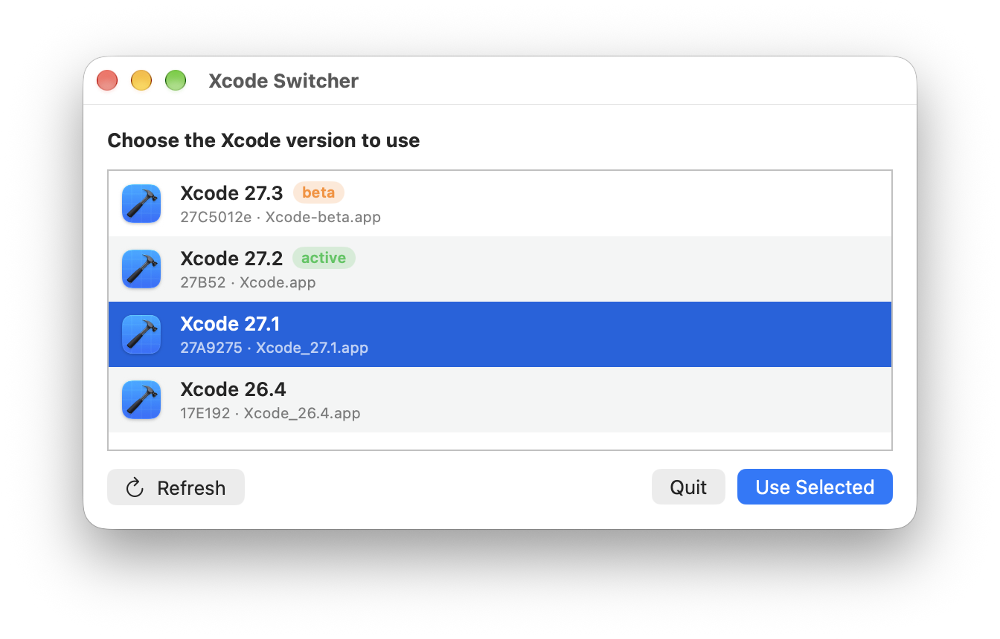

# Xcode Switcher

A small macOS app to switch between multiple Xcode versions installed in `/Applications`.

<p align="center"></p>

Open it, pick a version from the list, click **Use Selected**, and it will:

1. rename the chosen Xcode to `Xcode.app`;
2. rename every other Xcode to `Xcode_<version>.app` (e.g. `Xcode_27.1.app`);
3. run `xcode-select --switch /Applications/Xcode.app/Contents/Developer`.

No configuration files, no naming conventions to follow.

## Features

- **Auto-detection** — any app in `/Applications` with bundle identifier `com.apple.dt.Xcode` is listed,
  whatever its file name (`Xcode-beta.app`, `Xcode 27.app`, …). Version and build are read from the bundle.
- **Active / beta badges** — shows which Xcode `xcode-select` currently points to, and flags beta builds
  (build numbers ending in a lowercase letter, e.g. `27C5012e`).
- **Safe renaming** — renames in two phases so names can be swapped freely; if two installs share a
  version, the build number is appended (`Xcode_27.1_27A9275.app`); it never overwrites a file that
  isn't a detected Xcode.
- **Running Xcode check** — offers to quit Xcode before renaming it.
- **Single admin prompt** — renaming and `xcode-select` run together with administrator privileges.
- **Adjustable text size** — **View → Zoom In / Zoom Out / Actual Size** (⌘+ / ⌘− / ⌘0) scales text,
  icons and buttons from 80% to 200% in 10% steps. ⌘= also zooms in, for layouts where `+` needs Shift.
- **Light and dark mode** — follows the system appearance.

## Settings

There is nothing to configure. The only thing the app remembers is the zoom level, stored in its user
defaults (bundle ID `com.newsid.xcodeswitcher`). To reset it:

```sh
defaults delete com.newsid.xcodeswitcher
```

## Requirements

- macOS 13 or later (Apple Silicon or Intel). On macOS 13 the badges keep their tinted colours on the
  selected row; from macOS 14 they switch to white for contrast.
- An administrator account (needed to rename apps in `/Applications` and run `xcode-select`).
- To build: Xcode Command Line Tools (`swiftc`). No Xcode project is required.

## Build

```sh
./build.sh
```

Produces:

| Output | Description |
| --- | --- |
| `build/XcodeSwitcher.app` | Universal (arm64 + x86_64), ad-hoc signed app |
| `build/XcodeSwitcher-<version>.dmg` | Disk image with the app and an `Applications` shortcut, ready to share |

The version comes from `CFBundleShortVersionString` in `build.sh`.

## Install

Open the DMG and drag **XcodeSwitcher** to **Applications**.

The app is ad-hoc signed and not notarized, so macOS blocks it on first launch on other Macs. Either:

- launch it once, then go to **System Settings → Privacy & Security** and click **Open Anyway**, or
- run `xattr -dr com.apple.quarantine /Applications/XcodeSwitcher.app`.

## Dry run

Preview what a switch would do, without changing anything:

```sh
build/XcodeSwitcher.app/Contents/MacOS/XcodeSwitcher --dry-run          # list detected Xcodes
build/XcodeSwitcher.app/Contents/MacOS/XcodeSwitcher --dry-run 27.2     # show the rename plan for 27.2
```

## Project layout

```
Sources/XcodeSwitcher.swift   App source (detection, renaming, SwiftUI UI)
Resources/AppIcon.icns        App icon
docs/screenshot.png           Screenshot used in this README
build.sh                      Builds the .app and .dmg
```

## License

[MIT](LICENSE)
